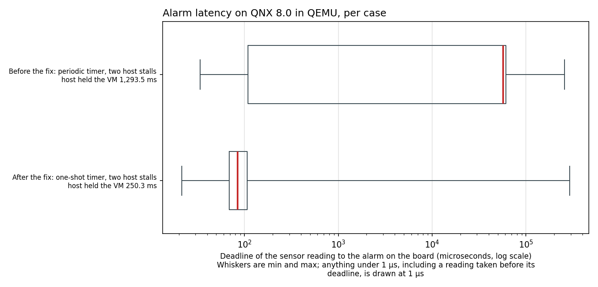

# Alarm latency of the bedside monitor on QNX 8.0 in QEMU

**Prototype for a hackathon, not a medical device.**

This report is for the hackathon's judges and for QNX developers who want to know what the monitor's priority design does to alarm latency, and how far a virtual machine can measure it. Everything in it can be run again from this repository, and every table that `tools/latency_report.py` printed for these runs is in [`LATENCY-TABLES.md`](LATENCY-TABLES.md).

The priority design held in every case. Under two threads spinning at FIFO priority 35 on both virtual CPUs, which also stop the guest's network stack and SSH, the designed monitor put 2984 clinical alarms on the board with a median of 55.9 µs from the reading's deadline. Under two threads at round-robin priority 10 its median was 42.5 µs, and with no load 93.9 µs. The naive build under the priority-35 hog raised 187 alarms, missed 3636 sensor deadlines, and its slowest alarm took 279,952.2 ms, the whole time the hog ran.

The six cases ran on 4 November 2026, one after another, starting between 07:12:57 and 07:39:21 KST, each while the host's one-minute load was under 10. The host kept the virtual CPUs waiting for 165.3 ms to 8,433.6 ms of each case of about 308 seconds. This build arms each sensor's timer at its own deadline. A stall test that freezes the whole VM twice shows the difference: the old build's timer wake stays about 57 ms and then 61 ms late for the rest of the run, and the fixed build's is back at its earlier level in the next ten seconds.

## Why this build changed

The first version of this report came from runs on the night of 4 November, from 01:40 to 05:41 KST, on an older build. Two of its cases ran while other jobs saturated the host, which kept the virtual CPUs waiting for 164,274.5 ms and 169,374.2 ms of 308 seconds, and they showed two faults of the monitor's own.

Each sensor ran on one periodic timer (`timer_settime()` with an interval). After a host stall of hundreds of milliseconds, every later expiry kept the late offset: in the designed case under the priority-10 hog, 25 of 29 ten-second medians of the timer wake were over 1 ms, up to 81.7 ms. Where the offset fell just before a deadline, the sensor took the pulse as on time, because it accepted a pulse up to 1 ms early, so 24 readings were taken up to 953.7 µs before their deadline. Separately, the monitor's summary in `monitor.log` once counted one alarm more than `latency.csv`, because `finish()` wrote the file and the summary while the alarm thread was still raising alarms.

Each sensor now arms a one-shot timer (`TIMER_ABSTIME`, `it_interval` zero) at one deadline at a time on the grid start + k × period, and after each reading arms the next. A stall makes one reading late, the deadlines it passed count as missed, and the next expiry is on the grid again. A deadline that passed while a reading was being sent fires at once and is measured late, so a sensor falling behind shows in the delays. No pulse before its deadline is taken as a reading: the kernel expires a timer only once `CLOCK_MONOTONIC` has reached it. The grid logic is plain C in `src/core/deadline.c` with a unit test. In the monitor, `finish()` first takes the lock the alarm thread holds for each batch and keeps it, so the record, `latency.csv` and the summary hold the same alarms.

## What was measured

Each case runs the probe scenario for 300 seconds. The oxygen saturation of beds 1 and 2 alternates between normal and a red score on every 100 ms reading, in opposite phase, so every reading starts a clinical alarm on one of the two beds, about ten a second. For each alarm the monitor keeps three times from the guest's `CLOCK_MONOTONIC`: the reading's deadline, the moment the sensor thread ran, and the moment the alarm was on the board. The total runs from the deadline to the alarm on the board, the timer wake from the deadline to the sensor thread running, and the alarm pipeline from there to the board.

The six cases are the ones in the codelab, section 8: the designed monitor with no load, on 1 ms tick timers with no load, and under two spinning threads at FIFO priority 35 and at round-robin priority 10, and the `--naive` build (every thread at priority 10, tick timers) under the same two loads. Each load starts ten seconds in and spins for 280 seconds on both virtual CPUs. Every case has four technical alarms at the start, one per bed, because the monitor starts a second before the sensors; technical alarms are left out of the clinical figures.

## Where it ran

The guest is QNX OS 8.0 (`procnto-smp-instr`, 8.0.0 2026/06/05) in an x86_64 QEMU image made by `mkqnximage`, with 2 virtual CPUs and 1 GB. The host is a shared workstation: an Intel Core i7-12700F (12 cores, 20 threads), Ubuntu 24.04, Linux 6.14, QEMU 8.2.2 with KVM, with the virtual CPUs not pinned to host cores. QNX keeps a 1 ms tick; the designed sensors ask for high-resolution timers (`TIMER_TOLERANCE` of 1 ns), which fire between ticks, and the tick-timer and naive cases use the default timers, which expire on the tick.

Each case records the host's load averages before and after it and how long the host kept the guest's two virtual CPU threads waiting for a processor (their run-queue wait from Linux's `/proc/PID/task/TID/schedstat`). The wait is the better measure: a load average counts everything runnable on a 20-thread host, while the wait is the delay the host imposed on this VM. The host's resting load is about 8, so a driver started each case only while the one-minute load was under 10 and would have started none after 07:44 KST.

## Results

#### Clinical alarms, total (deadline of the reading to the alarm on the board)

| Case | Alarms | Min | Median | 99th percentile | 99.9th percentile | Max |
|:---|---:|---:|---:|---:|---:|---:|
| Designed, no load | 2986 | 26.7 µs | 93.9 µs | 1,157.5 µs | 3,682.3 µs | 62.8 ms |
| Designed, tick timers, no load | 2986 | 679.9 µs | 766.3 µs | 2,611.1 µs | 17.2 ms | 34.0 ms |
| Designed, hog FIFO 35 | 2984 | 11.5 µs | 55.9 µs | 540.7 µs | 18.4 ms | 247.7 ms |
| Designed, hog RR 10 | 2985 | 13.9 µs | 42.5 µs | 188.0 µs | 16.3 ms | 53.2 ms |
| Naive, hog RR 10 | 2986 | 853.1 µs | 3,850.4 µs | 23.9 ms | 27.9 ms | 28.9 ms |
| Naive, hog FIFO 35 | 187 | 912.9 µs | 982.5 µs | 1,784.4 µs | 1,909.2 µs | 279,952.2 ms |

#### The host during each case (load averages over one, five and fifteen minutes, and the virtual CPUs' run-queue wait)

| Case | Host load before | Host load after | Host kept the virtual CPUs waiting | Times put on a processor | Mean wait each time |
|:---|:---|:---|---:|---:|---:|
| Designed, no load | 4.54 69.60 141.47 | 8.47 30.32 103.83 | 2,322.8 ms over 308 s, 2 virtual CPUs | 106,918 | 21.7 µs |
| Designed, tick timers, no load | 8.47 30.32 103.83 | 8.39 17.43 77.45 | 4,053.3 ms over 308 s, 2 virtual CPUs | 112,674 | 36.0 µs |
| Designed, hog FIFO 35 | 8.39 17.43 77.45 | 11.55 14.94 59.30 | 8,433.6 ms over 308 s, 2 virtual CPUs | 69,610 | 121.2 µs |
| Designed, hog RR 10 | 9.23 13.96 57.33 | 6.64 10.56 43.83 | 4,246.4 ms over 308 s, 2 virtual CPUs | 32,625 | 130.2 µs |
| Naive, hog RR 10 | 6.83 10.53 43.64 | 3.59 6.64 32.72 | 165.3 ms over 308 s, 2 virtual CPUs | 14,092 | 11.7 µs |
| Naive, hog FIFO 35 | 4.50 6.78 32.62 | 4.27 6.01 25.12 | 413.7 ms over 309 s, 2 virtual CPUs | 14,560 | 28.4 µs |

The high five- and fifteen-minute averages before the first cases are from a long job that held the host until shortly before 07:10 KST.

#### Timer phase (the median timer wake of each run of 100 clinical alarms, about ten seconds)

| Case | Lowest median | Highest median | Medians over 1 ms | Readings taken before their deadline | Earliest |
|:---|---:|---:|---:|---:|---:|
| Designed, no load | 55.0 µs | 89.9 µs | 0 of 29 | 0 | - |
| Designed, tick timers, no load | 700.5 µs | 779.9 µs | 0 of 29 | 0 | - |
| Designed, hog FIFO 35 | 15.4 µs | 58.7 µs | 0 of 29 | 0 | - |
| Designed, hog RR 10 | 12.2 µs | 68.9 µs | 0 of 29 | 0 | - |
| Naive, hog RR 10 | 874.0 µs | 1,875.9 µs | 28 of 29 | 0 | - |
| Naive, hog FIFO 35 | 932.8 µs | 932.8 µs | 0 of 1 | 0 | - |

#### Alarms counted (the monitor's own summary in monitor.log against the rows of latency.csv)

| Case | Clinical, summary | Clinical, latency.csv | Technical, summary | Technical, latency.csv | Same |
|:---|---:|---:|---:|---:|:---|
| Designed, no load | 2,986 | 2,986 | 4 | 4 | yes |
| Designed, tick timers, no load | 2,986 | 2,986 | 4 | 4 | yes |
| Designed, hog FIFO 35 | 2,984 | 2,984 | 8 | 8 | yes |
| Designed, hog RR 10 | 2,985 | 2,985 | 4 | 4 | yes |
| Naive, hog RR 10 | 2,986 | 2,986 | 4 | 4 | yes |
| Naive, hog FIFO 35 | 187 | 187 | 16 | 16 | yes |


## The stall test

`scripts/stall-test.sh` runs the designed monitor with no load for 120 seconds and freezes the whole QEMU process from the host with `kill -STOP` and `kill -CONT`, for 330 ms at 40 seconds and for 170 ms at 80 seconds. The guest's clock keeps running while it is frozen, so to QNX each stall looks like a host that held both CPUs. It ran on the old build (periodic timers) at 06:22:45 KST and on the fixed build at 07:10:45 KST. The windows below count the alarms by the ten seconds their reading was due in, from the first alarm's deadline, which comes about 1.5 seconds after the start the stall times count from.

| Seconds | Before the fix: median wake | Max wake | After the fix: median wake | Max wake |
|:---|---:|---:|---:|---:|
| 0 to 10 | 71.0 µs | 1,575.4 µs | 84.7 µs | 271.0 µs |
| 10 to 20 | 62.6 µs | 679.0 µs | 102.0 µs | 1,299.2 µs |
| 20 to 30 | 59.9 µs | 253.6 µs | 71.2 µs | 343.8 µs |
| 30 to 40 | 64.5 µs | 256.9 ms | 58.3 µs | 291.9 ms |
| 40 to 50 | 57.0 ms | 57.4 ms | 55.9 µs | 146.8 µs |
| 50 to 60 | 57.0 ms | 77.2 ms | 52.3 µs | 126.6 µs |
| 60 to 70 | 57.0 ms | 58.8 ms | 53.5 µs | 133.8 µs |
| 70 to 80 | 57.0 ms | 161.3 ms | 55.4 µs | 144.5 ms |
| 80 to 90 | 61.3 ms | 62.3 ms | 54.5 µs | 126.9 µs |
| 90 to 100 | 61.3 ms | 66.9 ms | 55.9 µs | 224.4 µs |
| 100 to 110 | 61.3 ms | 80.3 ms | 57.8 µs | 216.3 µs |
| 110 to 120 | 61.3 ms | 103.8 ms | 55.0 µs | 105.8 µs |

The stalls were 332.7 ms and 176.0 ms before the fix (at 06:23:25.374 and 06:24:05.341) and 332.1 ms and 172.2 ms after it (at 07:11:25.287 and 07:12:05.303). In both runs no reading was taken before its deadline, the monitor's summary counted the same alarms as `latency.csv` (1,182 and 1,184 clinical, 8 technical each), and the missed sensor deadlines were 5 and 3.

| Case | Host load before | Host load after | Host kept the virtual CPUs waiting | Lowest median | Highest median | Medians over 1 ms |
|:---|:---|:---|---:|---:|---:|---:|
| Before the fix: periodic timer, two host stalls | 8.52 22.63 90.32 | 11.14 18.81 80.38 | 1,293.5 ms over 128 s, 2 virtual CPUs | 59.9 µs | 61.3 ms | 7 of 11 |
| After the fix: one-shot timer, two host stalls | 7.98 105.28 162.11 | 4.76 70.74 142.23 | 250.3 ms over 128 s, 2 virtual CPUs | 53.2 µs | 102.0 µs | 0 of 11 |



Before the fix, the window holding the first stall has a slowest wake of 256.9 ms, and from then on every window's median is 57.0 ms: the periodic timer now expires 57 ms after each deadline. The second stall moves it to 61.3 ms for the rest of the run. After the fix, the windows holding the stalls have slowest wakes of 291.9 ms and 144.5 ms, the readings the stalls held up, and the medians do not move: 58.3 µs to 102.0 µs before the first stall, 52.3 µs to 55.9 µs between the stalls and 54.5 µs to 57.8 µs after the second. The last table's medians come from runs of 100 alarms and leave out the last, partial run, so they differ a little from the ten-second windows. A frozen process is not waiting for a processor, so the stalls are not in the host's wait; the old build's run had more of it because the host was busier then.

## What the figures show

Under the FIFO-35 hog the designed monitor's alarm pipeline had a median of 22.3 µs and a 99.9th percentile of 133.6 µs, against 27.9 µs and 446.8 µs with no load: the hog sits below every thread on the alarm path, and the path ran as if it were not there. Its total was faster than with no load too, and so was the case under the RR-10 hog, most likely because a busy guest kept the virtual CPUs from going idle. With no load they were put on a processor 106,918 times and under the RR-10 hog 32,625 times, and an idle virtual CPU waits for the host to wake it.

The same FIFO-35 case holds the night's slowest designed alarm, 247.7 ms, and its 2 missed deadlines. Both came from one stall (its `latency.csv` has no other reading held up that long), which also left each bed's pulse oximeter silent for three of its periods, hence four technical alarms more than the other designed cases. The sensor and alarm threads outrank every other thread the test runs, so a delay that long most likely came from the host, and this case had the largest host wait of the six, 8,433.6 ms. Its 29 ten-second medians of the timer wake stayed between 15.4 µs and 58.7 µs, so the fixed timer went back to its deadlines after a real stall too.

With no load, the designed sensors' timer wake had a median of 65.6 µs; on tick timers it was 734.7 µs, and no sensor thread ran sooner than 658.6 µs after its deadline, because a tick timer expires on a tick. The alarm pipelines were about the same (medians of 27.9 µs and 30.9 µs), so the difference is the timer alone, and arming the timer anew for each deadline keeps the high-resolution setting.

The naive monitor under the FIFO-35 hog stopped for the whole of the hog's run, and its 16 technical alarms, 12 more than the four at the start, show the sensor silences; when its alarm pipeline did run, its median was 24.4 µs. Under the RR-10 hog it shares the processors with the hog in round-robin turns, and its alarm pipeline's median was 1,999.3 µs, against 21.6 µs for the designed monitor under the same hog. Its timer wake never went above 4,881.7 µs, so its 28 medians over 1 ms are the tick and the wait for the hog's turn to end, not a timer that kept a late phase. The host held the VM least in these two cases (165.3 ms and 413.7 ms), so their figures are the guest's own.

The 99.9th percentile and the maximum come from a few alarms out of 2984 to 2986, and these runs cannot tell, alarm by alarm, a host stall from a delay inside the guest, so treat the tails as this host's rather than QNX's.

## What a virtual machine can and cannot show

A virtual machine shows how QNX schedules the monitor's threads against each other and against a load inside the guest. Whether the priority design keeps the alarm path ahead of a priority-35 hog, and whether the naive build starves under it, does not depend on the machine, so those results carry over to hardware.

The absolute times do not. In a VM, a timer interrupt is a host timer that KVM turns into an interrupt for a virtual CPU, which is a host thread the host has to schedule, and every microsecond the host makes it wait is added to the timer wake. The host table is there so that a case the host disturbed can be told apart from a case the design got wrong. On hardware the same span would be QNX's own interrupt and scheduling latency on that board, and it has to be measured there.

The VM cannot show interrupt latency from a real sensor or bus, since the sensors here are threads that read simulated values, nor the cost of a particular board's drivers, caches and power states, nor a worst case. With about 2,985 alarms a case, the 99.9th percentile is the fourth-slowest alarm, and in a VM the slowest one is set by the host's worst stall. A worst case needs long runs on the target hardware with its configuration fixed.

## How to repeat it

```sh
source ~/qnx800/qnxsdp-env.sh && make test && make qnx
scripts/qemu-vm.sh start ~/qnx-vm/phila && scripts/qemu-vm.sh wait ~/qnx-vm/phila
scripts/latency-runs.sh ~/qnx-vm/phila 300                     # all six cases into results/latency/
scripts/latency-runs.sh ~/qnx-vm/phila 300 designed-hog35      # one case again
scripts/stall-test.sh ~/qnx-vm/phila after-fix                 # into results/stall-test/after-fix/
QNX_BUILD=/path/to/older/build/qnx-x86_64 scripts/stall-test.sh ~/qnx-vm/phila before-fix
python3 tools/latency_report.py results/latency --chart docs/latency.png
python3 tools/latency_report.py results/stall-test --chart docs/stall-test.png
scripts/qemu-vm.sh stop ~/qnx-vm/phila
```

On a shared host, start each case only while the host is quiet. `latency-runs.sh` can wait for a load average (`QUIET_LOAD`), but after `QUIET_WAIT` seconds it runs the case anyway; these runs came from a driver that waited for a one-minute load under 10 before each case and started none after a fixed time. The result folders hold every case's files as fetched from the guest, with `host.txt` holding the host's load, its hold on the virtual CPUs and, for the stall test, the stalls. The record files (`record.jsonl`, up to about 1.9 MB a case) are left out of the repository.
