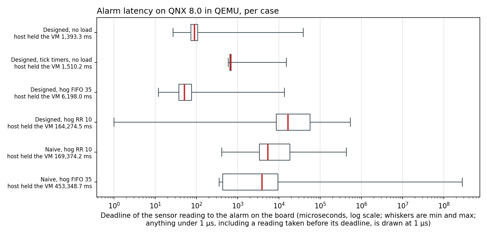

# Alarm latency of the bedside monitor on QNX 8.0 in QEMU

**Prototype for a hackathon, not a medical device.**

This report is for the hackathon's judges and for QNX developers who want to know what the monitor's priority design does to alarm latency, and how far a virtual machine can measure it. Everything in it can be run again from this repository.

In the cases the host disturbed least, the priority design held. Under two threads spinning at FIFO priority 35 on both virtual CPUs, which also stop the guest's network stack and SSH, the designed monitor put 2987 clinical alarms on the board with a median of 50.6 µs from the reading's deadline and missed no sensor deadline; with no load the median was 88.7 µs. The naive build under the same hog raised 188 alarms, missed 3636 sensor deadlines, and its slowest alarm took 279,954.2 ms, the whole time the hog ran: at priority 10 the naive monitor cannot run while a FIFO thread at 35 holds both processors, however quiet or busy the host is.

The two cases with the hog at priority 10 ran while other jobs saturated the host, which kept the virtual CPUs waiting for 164,274.5 ms and 169,374.2 ms of their 308-second runs, so their figures describe the host more than the monitor. They also showed that after a long host stall a sensor's periodic timer keeps the late phase, which this build does not guard against.

## What was measured

Each case runs the probe scenario for 300 seconds. The oxygen saturation of beds 1 and 2 alternates between normal and a red score on every 100 ms reading, in opposite phase, so every reading starts a clinical alarm on one of the two beds: about ten a second. For each alarm the monitor keeps three times from the guest's `CLOCK_MONOTONIC`: the reading's deadline, the moment the sensor thread ran, and the moment the alarm was on the board. The tables give three spans from them. The total runs from the reading's deadline to the alarm on the board, the timer wake from the deadline to the sensor thread running, and the alarm pipeline from the sensor thread running to the alarm on the board.

The six cases are the ones in the codelab, section 8: the designed monitor with no load, the designed monitor on 1 ms tick timers with no load, the designed monitor under two spinning threads at FIFO priority 35 and at round-robin priority 10, and the `--naive` build (every thread at priority 10, tick timers) under the same two loads. Each load starts ten seconds into the case and spins for 280 seconds on both virtual CPUs.

Every case also has four technical alarms, one per bed. They come from the start: the monitor starts a second before the sensors, so each bed's pulse oximeter has been silent for three of its periods when the first supervisor check runs, and the alarm clears when the readings arrive. They are counted in the tables and left out of the clinical figures.

## Where it ran

The guest is QNX OS 8.0 (`procnto-smp-instr`, 8.0.0 2026/06/05) in an x86_64 QEMU image made by `mkqnximage`, with 2 virtual CPUs and 1 GB. The host is a shared workstation: an Intel Core i7-12700F (12 cores, 20 threads), Ubuntu 24.04, Linux 6.14, QEMU 8.2.2 with KVM. The virtual CPUs were not pinned to host cores, so they could run on any of them, performance or efficiency, and other jobs ran on the host through the night.

The guest's clock is in the last line of the results: QNX 8.0 keeps a 1 ms tick, and `ClockCycles()` counts the processor's time-stamp counter. The designed sensors ask for high-resolution timers (`TIMER_TOLERANCE` of 1 ns), which fire between ticks; the tick-timer and naive cases use the default timers, which expire on the tick.

Each case records the host's one-minute load average when it started and ended, and how long the host kept the guest's two virtual CPU threads waiting for a processor during the case (their run-queue wait from Linux's `/proc/PID/task/TID/schedstat`). The run-queue wait is the better measure: a load average counts everything runnable on a 20-thread host, while the wait is the delay the host imposed on this VM.

The plan was to start each case only when the host's one-minute load was below 2.5. On this 20-thread host it never fell that low during the night. The first case started at 01:40:23 KST after the full 30-minute wait, at a load of 8.48. From about 02:00 other jobs kept the host far busier for most of the night, so each remaining case started when the one-minute load dropped below 10, except the naive case under the priority-35 hog, which started at once because its result does not depend on the host. In two cases the load rose far above 10 while the case ran; the host's hold table shows how much each case was disturbed. No case could be run again that night: from 05:41 KST, when the last case ended, a repeat waited for a one-minute load under 10, checking every 30 seconds, and found none before it was stopped at 06:01 KST. The one-minute load of 216.72 after the last case shows how busy the host still was.

## Results

**Clinical alarms, total** (Deadline of the reading to the alarm on the board)

| Case | Alarms | Min | Median | 99th percentile | 99.9th percentile | Max |
|:---|---:|---:|---:|---:|---:|---:|
| Designed, no load | 2981 | 26.9 µs | 88.7 µs | 450.1 µs | 8,952.9 µs | 38.6 ms |
| Designed, tick timers, no load | 2986 | 592.2 µs | 667.2 µs | 1,236.2 µs | 4,659.3 µs | 15.2 ms |
| Designed, hog FIFO 35 | 2987 | 11.9 µs | 50.6 µs | 442.1 µs | 6,890.6 µs | 13.6 ms |
| Designed, hog RR 10 | 2946 | -931.7 µs | 16.5 ms | 94.6 ms | 408.9 ms | 533.8 ms |
| Naive, hog RR 10 | 2916 | 410.6 µs | 5,375.2 µs | 121.1 ms | 221.7 ms | 431.5 ms |
| Naive, hog FIFO 35 | 188 | 353.9 µs | 3,607.8 µs | 31.7 ms | 37.5 ms | 279,954.2 ms |

**Clinical alarms, timer wake** (Deadline to the sensor thread running)

| Case | Alarms | Min | Median | 99th percentile | 99.9th percentile | Max |
|:---|---:|---:|---:|---:|---:|---:|
| Designed, no load | 2981 | 10.7 µs | 62.8 µs | 360.7 µs | 8,646.5 µs | 38.6 ms |
| Designed, tick timers, no load | 2986 | 570.1 µs | 642.5 µs | 1,196.0 µs | 4,624.4 µs | 15.1 ms |
| Designed, hog FIFO 35 | 2987 | 6.1 µs | 28.7 µs | 327.3 µs | 6,864.3 µs | 13.6 ms |
| Designed, hog RR 10 | 2946 | -953.7 µs | 16.5 ms | 94.5 ms | 408.8 ms | 533.8 ms |
| Naive, hog RR 10 | 2916 | -373.8 µs | 2,382.7 µs | 109.9 ms | 221.7 ms | 368.0 ms |
| Naive, hog FIFO 35 | 188 | 327.7 µs | 3,565.6 µs | 31.7 ms | 37.5 ms | 279,954.1 ms |

**Clinical alarms, alarm pipeline** (Sensor thread running to the alarm on the board)

| Case | Alarms | Min | Median | 99th percentile | 99.9th percentile | Max |
|:---|---:|---:|---:|---:|---:|---:|
| Designed, no load | 2981 | 8.3 µs | 25.5 µs | 83.2 µs | 1,278.2 µs | 10.2 ms |
| Designed, tick timers, no load | 2986 | 10.5 µs | 22.7 µs | 70.8 µs | 127.8 µs | 138.9 µs |
| Designed, hog FIFO 35 | 2987 | 5.3 µs | 21.9 µs | 76.1 µs | 122.9 µs | 1,799.0 µs |
| Designed, hog RR 10 | 2946 | 8.9 µs | 28.4 µs | 94.7 µs | 10.5 ms | 47.5 ms |
| Naive, hog RR 10 | 2916 | 9.1 µs | 2,457.5 µs | 22.9 ms | 51.2 ms | 147.0 ms |
| Naive, hog FIFO 35 | 188 | 17.4 µs | 31.2 µs | 83.0 µs | 85.6 µs | 119.6 µs |

**Each run**

| Case | Technical alarms | Missed sensor deadlines | Hog | Started | Host load before | Host load after |
|:---|---:|---:|:---|:---|:---|:---|
| Designed, no load | 4 | 0 | none | 2026-11-04 01:40:23 KST | 8.48 9.21 10.20 | 7.59 7.86 9.25 |
| Designed, tick timers, no load | 4 | 0 | none | 2026-11-04 03:27:43 KST | 9.46 47.77 67.36 | 3.23 20.12 49.81 |
| Designed, hog FIFO 35 | 4 | 0 | 2 threads, fifo priority 35, 280 s | 2026-11-04 03:32:53 KST | 3.53 19.91 49.58 | 16.48 15.42 39.03 |
| Designed, hog RR 10 | 40 | 42 | 2 threads, rr priority 10, 280 s | 2026-11-04 03:39:04 KST | 9.95 13.83 36.89 | 87.27 57.57 48.54 |
| Naive, hog RR 10 | 8 | 65 | 2 threads, rr priority 10, 280 s | 2026-11-04 05:30:18 KST | 8.82 63.08 122.99 | 174.71 97.38 116.50 |
| Naive, hog FIFO 35 | 20 | 3636 | 2 threads, fifo priority 35, 280 s | 2026-11-04 05:36:28 KST | 185.92 114.89 121.34 | 216.72 180.89 148.27 |

**Timer phase** (the median timer wake of each run of 100 clinical alarms, about ten seconds; a lasting shift means the sensor timer kept a late phase)

| Case | Lowest median | Highest median | Medians over 1 ms | Readings taken before their deadline | Earliest |
|:---|---:|---:|---:|---:|---:|
| Designed, no load | 54.5 µs | 93.5 µs | 0 of 29 | 0 | - |
| Designed, tick timers, no load | 618.9 µs | 671.0 µs | 0 of 29 | 0 | - |
| Designed, hog FIFO 35 | 15.3 µs | 57.6 µs | 0 of 29 | 0 | - |
| Designed, hog RR 10 | 18.0 µs | 81.7 ms | 25 of 29 | 24 | -953.7 µs |
| Naive, hog RR 10 | 440.3 µs | 90.6 ms | 28 of 29 | 2 | -373.8 µs |
| Naive, hog FIFO 35 | 401.2 µs | 401.2 µs | 0 of 1 | 0 | - |

**The host's hold on the virtual machine** (run-queue wait of the VM's virtual CPU threads during each case)

| Case | Host kept the virtual CPUs waiting | Times put on a processor | Mean wait each time |
|:---|---:|---:|---:|
| Designed, no load | 1,393.3 ms over 308 s, 2 virtual CPUs | 107,422 | 13.0 µs |
| Designed, tick timers, no load | 1,510.2 ms over 308 s, 2 virtual CPUs | 106,484 | 14.2 µs |
| Designed, hog FIFO 35 | 6,198.0 ms over 308 s, 2 virtual CPUs | 35,837 | 172.9 µs |
| Designed, hog RR 10 | 164,274.5 ms over 308 s, 2 virtual CPUs | 237,632 | 691.3 µs |
| Naive, hog RR 10 | 169,374.2 ms over 308 s, 2 virtual CPUs | 105,737 | 1,601.8 µs |
| Naive, hog FIFO 35 | 453,348.7 ms over 309 s, 2 virtual CPUs | 96,571 | 4,694.5 µs |

Guest clock (pidin syspage=qtime, every case): tick 1 ms (nsec_inc 1000000 ns); ClockCycles() at 2,112,191,354 per second, 0.47 ns a cycle.



## What the figures show

### The priority design under load

Under the FIFO-35 hog the designed monitor's 99th percentile was 442.1 µs, against 450.1 µs with no load, and its alarm pipeline's median was 21.9 µs against 25.5 µs. The hog sits below every thread on the alarm path, and the alarm path ran as if it were not there. It even ran a little faster, probably because the spinning hog kept the virtual CPUs from going idle: with no load they were put on a processor 107,422 times and under the hog 35,837 times, and a virtual CPU that has gone idle waits for the host to wake it and schedule it again.

### High-resolution timers against the tick

With no load, the designed sensors' timer wake had a median of 62.8 µs. On the default 1 ms tick timers it was 642.5 µs, and no sensor thread ran sooner than 570.1 µs after its deadline, because a tick timer expires on a tick, not at the deadline. The alarm pipeline was the same in both (medians of 25.5 µs and 22.7 µs), so the difference is the timer alone.

### The naive build

Under the FIFO-35 hog the naive monitor stopped for the whole of the hog's run, and 20 sensor silences raised technical alarms. When its alarm pipeline did run, its median was 31.2 µs; the delay is all in waiting for a processor. Under the RR-10 hog the naive monitor shares the processors with the hog in round-robin slices, and its alarm pipeline's median was 2,457.5 µs, against 28.4 µs for the designed monitor under the same hog. The host held the virtual CPUs for similar times in those two cases, so the comparison between them is fair, but neither is a figure for an undisturbed host.

### The timer phase after a stall

The timer-phase table takes the median timer wake of every run of 100 alarms, about ten seconds each. In the three designed cases the host disturbed least, every one of those medians stayed between 15.3 µs and 671.0 µs. In the designed case under the RR-10 hog, 25 of 29 were over 1 ms, up to 81.7 ms. Read in order in that case's `latency.csv`, the wake does not scatter: it holds one offset for many seconds, changes after a stall of hundreds of milliseconds, and keeps the new offset until the next stall.

Each sensor runs on one periodic timer (`timer_settime()` with an interval), and the pattern fits a timer whose next expiry is counted from a late expiry rather than from its schedule. We did not isolate whether QNX's timer code or the virtual timer underneath it does this. Once the host had held a sensor thread past its deadline, every later reading of that sensor came late by the same amount. When the new phase fell within 1 ms before a deadline, the sensor took the pulse for an early one (it accepts a pulse up to 1 ms early, because a high-resolution timer can fire slightly early) and read before the deadline. Those are the 24 readings in the table, the earliest 953.7 µs before its deadline, and the reason the total table shows a minimum of -931.7 µs for that case. Arming each sensor's next expiry at its own absolute deadline would keep one late reading from moving the ones after it; this build arms one periodic timer per sensor.

### The tails of the least disturbed cases

Even in those three cases the 99.9th percentile and the maximum come from a few alarms out of 2981 to 2987, and the host still held the virtual CPUs for 1,393.3 ms to 6,198.0 ms per case. These runs cannot tell, alarm by alarm, a host stall from a delay inside the guest, so treat the tails here as this host's rather than QNX's.

### Technical alarms and the monitor's own summary

The extra technical alarms in the disturbed and starved cases are sensors that went silent for three periods while the host or the hog held them. The monitor's own summary line in `monitor.log` can count one alarm more than `latency.csv`, because the alarm thread is still running while the monitor writes the file at the end; it did once, in the tick-timer case. The tables here come from `latency.csv`.

## What a virtual machine can and cannot show

A virtual machine shows how QNX schedules the monitor's threads against each other and against a load inside the guest. Whether the priority design keeps the alarm path ahead of a priority-35 hog, and whether the naive build starves under it, does not depend on the machine, so those results carry over to hardware as they are.

The absolute times do not carry over. In a VM, a timer interrupt is a host timer that KVM turns into an interrupt for a virtual CPU, and that virtual CPU is a host thread the host has to schedule. Every microsecond the host makes it wait is added to the timer wake. The host's hold table is there so that a case the host disturbed can be told apart from a case the design got wrong. On hardware the same span would be QNX's own interrupt and scheduling latency on that board, with no second scheduler underneath, and it has to be measured there.

What the VM cannot show at all: interrupt latency from a real sensor or bus, since the sensors here are threads that read simulated values; the cost of device drivers, caches and power states on a particular board; and a worst case. In the cases with 2916 to 2987 alarms, the 99.9th percentile is the fourth-slowest alarm and the maximum is the slowest one, and in a VM the slowest one is set by the host's worst stall. A statement about the worst case needs long runs on the target hardware, with its configuration fixed.

## How to repeat it

```sh
source ~/qnx800/qnxsdp-env.sh && make test && make qnx
scripts/qemu-vm.sh start ~/qnx-vm/phila && scripts/qemu-vm.sh wait ~/qnx-vm/phila
QUIET_LOAD=2.5 scripts/latency-runs.sh ~/qnx-vm/phila 300           # all six cases into results/latency/
LATENCY_OUT=results/latency-repeat scripts/latency-runs.sh ~/qnx-vm/phila 300 designed-idle   # one case again, in its own folder
python3 tools/latency_report.py results/latency --chart docs/latency.png
scripts/qemu-vm.sh stop ~/qnx-vm/phila
```

`results/latency/` holds every case's files as fetched from the guest: the monitor's and sensors' logs, `latency.csv` with every alarm's times, the hog's log, `uname -a`, `pidin info`, the guest clock from `pidin syspage=qtime`, the snapshots taken under load and `host.txt` with the host's load and its hold on the virtual CPUs. The record files (`record.jsonl`, about 1.8 MB a case) are left out of the repository.
